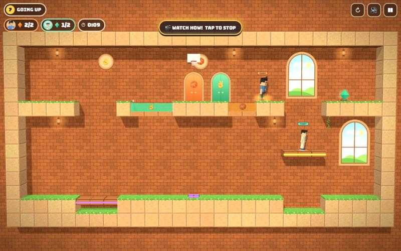
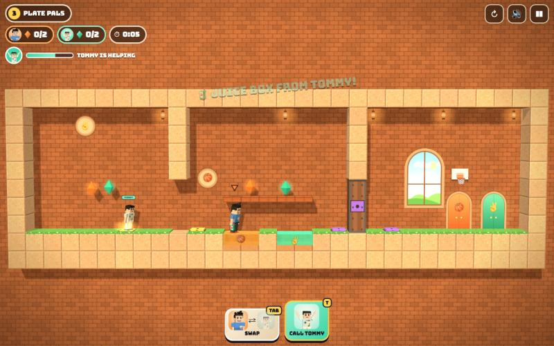
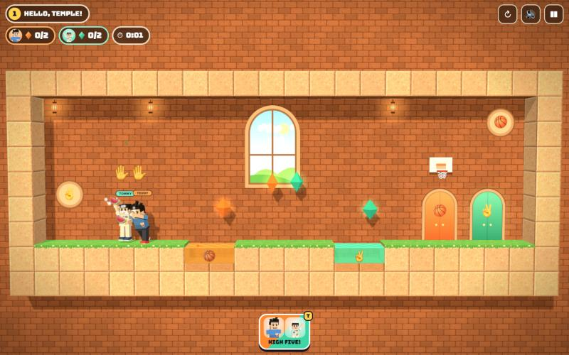

# BeTTer TogeTTher (working title)

[](https://adong.github.io/coop-brothers/)

Press **?** any time (or tap the round **?** button on the left edge) to see the keys. The game waits while you look.
Tap the language button under it (the A文 icon) to switch between English and 中文; the dashboard and every game remember the choice.

A co-op puzzle platformer starring Teddy and Tommy, built with Claude Code from plain JavaScript and Three.js.
The brothers explore a cosy backyard temple: Teddy is 🏀 orange and Tommy is ✌️ mint, and each one can only splash
through pools and walk through gates of his own colour. They help each other with pressure plates, levers, lifts
and crates to get **both** of them home to their doors.
There are no image, model or audio files: textures are painted on canvases, the people are built from boxes by the
shared kit, and every sound is synthesised.



## Play

- **Double-click `index.html`.** It works offline because Three.js and the kit are copied into `kit/`.
- **Send one file:** `dist/coop-brothers.html` is the whole game in one page (about 800 KB). AirDrop or email it, then open it in a browser.
- Rebuild that file after any edit: `python3 kit/tools/bundle.py . --name coop-brothers`
- The two fonts load from Google Fonts when online. Offline, the game falls back to Arial Black and the system font.
- The name lives in one constant, `CB.TITLE` in `js/title.js`.

| | Keys | Touch |
|---|---|---|
| **2 players**: Teddy | A D to walk, W to jump | the orange buttons on the left |
| **2 players**: Tommy | ← → to walk, ↑ to jump | the mint buttons on the right |
| **1 player** | A D or ← → to walk, W, ↑ or Space to jump | ◀ ▶ on the left, ▲ on the right |
| switch brothers (1 player) | Tab | the ⇄ SWAP button |
| the companion | T | the big button with your brother's face (bottom middle) |
| pause / start again / sound | P or Esc / R / M | ❚❚ / ↻ / 🔊 at the top right |

On an iPad, two kids can share the screen: Teddy's buttons are on the left and Tommy's on the right.

## How it works

- **Pick 1 PLAYER or 2 PLAYERS** on the title (behind it, the brothers play the first levels by themselves), then a level.
  Levels 1 and 2 are open; each finished level opens the next. "open every level" on the level screen unlocks them all.
- **Colours:** Teddy wades through orange pools and walks through orange gates; Tommy does the same with mint.
  Stepping into the other colour, or into purple grape jelly (too sticky for both), is a harmless **SPLASH!**:
  a cartoon sploosh and a boing, and he pops back up at his last checkpoint flag. Nothing is scary and nobody gets hurt.
- **Puzzles:**
  - **Pressure plates** open the door with the same colour and symbol while someone (or a crate) stands on them.
  - **Levers** flip when you bump into them; all levers of one colour are one switch.
  - **Lifts** ride up while their plate is held or their lever is on. Some rafts shuttle back and forth on their own.
  - **Crates** can be pushed, stood on, dropped into a hole to hold a plate down, and they **float** on pools,
    so you can push one into your pool to make a stepping stone for your brother.
  - **Coloured buttons** (🏀 or ✌️) only work for that brother. The big temple doors need **both** buttons at once.
  - **Gems:** orange ones for Teddy, mint ones for Tommy.
- **The double exit:** when both brothers stand at their doors, the doors glow open and they celebrate with their
  signature moves (Teddy's boxing combo and a basketball jump shot into the hoop over his door, Tommy's Y pose with
  peace fingers), with confetti.
- **Stars** for each level: ⭐ both home, ⭐ every gem, ⭐ beat the clock (the par times are generous).
  They are saved in the browser, so `index.html` and the single page each keep their own.
- **Camera:** the whole level shows while its name and tip are up; then big levels are framed around the brothers
  (at least 20 × 12 tiles), zooming out when they're far apart, so they stay big on an iPad.
- **🎬 SHOW ME HOW** in the pause menu plays the level's solution as a demo. Tap or press any key to stop it.

### The levels

| # | Level | New idea |
|---|---|---|
| 1 | Hello, Temple! | your own colour's pool, jumping over the other's (tiny, for Tommy) |
| 2 | Splash Garden | wooden ledges you can jump up through, a checkpoint flag |
| 3 | Plate Pals | plates and doors: take turns holding the door |
| 4 | Lever Lift | levers and a lift: send each other up |
| 5 | Crate Mate | push a crate into a hole to hold a plate; only Tommy can push it through mint |
| 6 | Both Buttons | orange and mint gates, both brothers on their buttons to open the big door |
| 7 | Going Up | each brother holds a plate to lift the other |
| 8 | Grape Jelly | purple jelly for both, a raft, a bridge that needs a plate on each side |
| 9 | Crate Lift | take the crate up in the lift, then into a hole behind an orange pool |
| 10 | The Grand Gate | crates float: stepping stones across each other's pools, both buttons, a raft home |

## The companion

Alan's rule for every game, adapted here because both brothers are already playable.

- **1 player:** press **T** or tap the big button with your brother's face. The brother you're **not** steering comes
  to help for about 10 s, with his name tag over his head and a bar with his face in the HUD:
  - he leaps over to you, says hi with his signature move (Tommy's peace Y, Teddy's boxing) and hands you a treat:
    🍦 💧 🧃 🍪 🍉 or 🍌 arcs into your hand ("🧃 JUICE BOX FROM TOMMY!");
  - he stands on the nearest **pressure plate you need** (one whose door or lift is near you and isn't held already),
    or walks along with you;
  - while he's helping, a wrong-pool splash doesn't send you back: he lifts you out to dry ground ("TOMMY SAVED YOU!");
  - then he says bye (Tommy's Y again, or Teddy's jump shot with a 🏀) and leaps back to where he was, so the puzzle is
    the way you left it. If he was already holding a plate down, he stays on it and throws the treat over instead.
  - Tapping again gives another treat and keeps him a little longer. Tab sends him home straight away.

  

- **2 players:** the button (or T) is a **high five**: ✋ pops up over both, they do their signature moves, and they
  swap treats ("🍪 COOKIE FROM TEDDY!", "🍉 WATERMELON FROM TOMMY!"). Tap again for another one.

  

## Proving every level can be finished

Every level has a scripted solution (`solution` in `js/levels.js`) written as simple steps like `T@12.5` (Teddy walks
to x = 12.5), `M^@15.5` (Tommy jumps and keeps going) or `L=1` (wait for lift L to reach the top). The same
simulation the game uses plays it headlessly:

```bash
node tools/check.js
```

It plays each level twice, as two players and as one player (one brother at a time with swaps; the two-player
script is split up automatically, or `solution1p` is used), and checks that both brothers reach their doors with
**every gem**. It also proves the check can fail: doing nothing must never win. Last run: all 10 levels solved with
every gem in both modes, no splashes, and every idle run failed. `node tools/check.js 4` shows level 4 alone with a
picture of where the brothers ended up.

In the browser console: `game.solveAll()` runs the same checks, and `game.demo(4)` plays level 4's solution on screen.

Other test hooks (the Browser pane throttles animation when hidden, so tests drive the game themselves):
`game.step(seconds)` ticks and draws synchronously, `game.hold(true)` stops real-time ticking, `game.keepAwake()`
stops the pause when the page is hidden, `game.start(level, '1p' | '2p')`, `game.press('KeyD')` / `game.press('KeyD', false)`,
`game.touch('t-right')`, `game.call()`, `game.swap()`, `game.state()`. `index.html?level=4&mode=1p` opens a level directly.

## Files

```
index.html       page, HUD, touch pads and screens (CSS inline)
js/title.js      the game's name (one constant)
js/sim.js        the rules: tiles, collisions, crates, plates, levers, doors, lifts, pools, gems, flags, exits,
                 the companion helper, and the solution bot; no Three.js, so it also runs in Node
js/levels.js     the 10 levels (ASCII maps), their tips, par times and scripted solutions
js/art.js        canvas-painted textures: sandstone, bricks, grass, planks, crates, gates, pools, doors, windows
js/view.js       the Three.js scene: builds each level, the brothers, effects, treats, the jump shot, the camera
js/poses.js      extra poses on top of Kit.people.pose (stand, push, wade, splash, cheer)
js/sfx.js        sounds made with Kit.sound.tone / hiss
js/game.js       screens, input, companion button, HUD, stars and saving, title demo, test hooks
js/keys.js       the keys the ? panel shows (Kit.help)
js/zh.js         中文: the game's words for Kit.lang (TEDDY, TOMMY and the game's name stay in English)
tools/check.js   plays every solution headlessly (node tools/check.js)
kit/             copy of ~/claude-games/kit (python3 ../kit/tools/sync.py .); don't edit it here
docs/            screenshots
dist/coop-brothers.html   the single-page build
```

## Kit candidates

Written here first; worth moving into `~/claude-games/kit` if another game wants them:

- **Instanced-mesh gotcha:** sharing one material between an `InstancedMesh` with per-instance colours and one
  without draws the second one black. Give each its own material (see the pool basins in `js/view.js`).
- **Poses** (`js/poses.js`): `stand`, `push`, `wade`, `splash`, `cheer`, and standing `peace` / `wave` with still legs.
- **A side-view person facing left or right but turned a little toward the camera** (`syncBro` in `js/view.js`):
  `rotation.y = ±(π/2 + 0.45)` reads much better than a flat profile.
- **Treat hand-over between any two people** (`throwTreat` in `js/view.js`) and a jump shot aimed at any point.
- **A particle pool with per-particle alpha and size** in one `THREE.Points` draw call (`makeParticles` in `js/view.js`).
- **A follow camera that frames two players** and never zooms out past the whole level (`fit` in `js/view.js`).

## Not verified

- **Sound:** the effects and music are wired to the kit, but nobody listened in this build (the test browser has no audio check).
- **Real touch devices:** touch was tested with simulated touch input at iPad size in the Browser pane, not on a real iPad or phone.
- **Real kids:** the difficulty curve and the par times are guesses until Teddy and Tommy play it.
